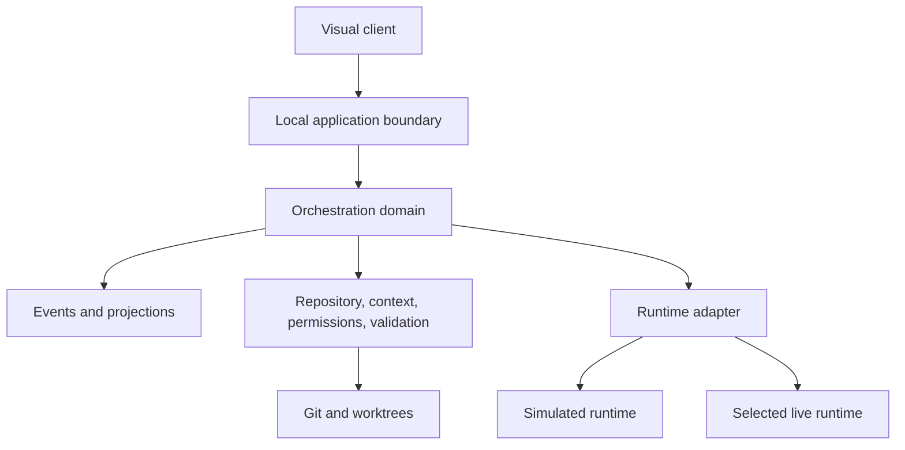

# Visual Multi-Agent Harness

## Private MVP Build Brief and Model-Ready Implementation Handoff

**Status:** Ready for implementation planning and repository scaffolding  
**Version:** 0.1  
**Date:** September 18, 2026  
**Audience:** Coding models, software engineers, product designer, and product owner  
**Delivery mode:** Private, single-user, local-first prototype  
**Authoritative product source:** `visual-multi-agent-harness-product-spec.md`, version 0.3  

---

## 1. Purpose of this brief

This document converts the product specification into an executable MVP build plan. It should give a capable coding model or engineer enough context to make strong technical decisions without turning early assumptions into rigid implementation rules.

It defines:

- the first complete product slice;
- the boundaries that must remain stable;
- the architectural seams most likely to change;
- the minimum domain contracts and state model;
- the recommended, but replaceable, implementation direction;
- the order in which risk should be removed;
- the expected visual and interaction behavior;
- the security, recovery, and validation requirements;
- the evidence required before the MVP is considered complete;
- how an implementation agent should report decisions, deviations, and results.

This is not a request to generate the entire product in one pass. The product should be built as a series of controlled vertical increments. Each increment must leave the application in a coherent, testable state.

If this brief and the product specification conflict, use the product specification for product intent and this brief for MVP implementation scope. Surface any conflict that would materially change user behavior, safety, or architecture before proceeding.

---

## 2. Build thesis

The MVP must prove one proposition:

> A single user can give a local coding goal to a visual control plane, understand how the work was decomposed and equipped, supervise one to three isolated agents, and receive an integrated result with visible evidence.

The prototype is successful only if it makes agent work easier to understand and safer to coordinate. A visually impressive graph without reliable state, scope, recovery, or verification does not prove the product. A capable orchestration backend without a clear visual explanation also does not prove it.

The first build therefore prioritizes the complete comprehension loop:

1. Open a repository.
2. Assess its instructions and available capabilities.
3. Select or create a reusable methodology.
4. Enter a software goal.
5. Review an explainable task plan.
6. Approve and launch the run.
7. Observe task, agent, skill, dependency, and approval state.
8. Intervene when needed.
9. Integrate in dependency order.
10. Review the diff and validation evidence.

### 2.1 Primary user

The product owner is the only required user for the private MVP. The initial use case is an AI-forward developer working on local web applications, especially TypeScript repositories.

The architecture should not assume that there will only ever be one user, repository type, operating system, model provider, or runtime. However, the MVP must not implement accounts, organizations, shared projects, remote workers, billing, or generalized provider support merely to preserve a theoretical future.

### 2.2 MVP operating envelope

| Dimension | MVP boundary |
| --- | --- |
| Users | One local user |
| Projects | One open project at a time; multiple projects may be stored locally |
| Repository location | Local filesystem |
| Primary repository class | TypeScript/web application; generic Git operations where practical |
| Concurrent writing agents | Zero to three |
| Runtime integrations | One simulated adapter and one live adapter |
| Models | Selected through the live adapter; no model hard-coded into the domain |
| Persistence | Local only |
| Execution isolation | Git worktrees or an equivalent local isolation mechanism |
| Deployment | Never autonomous; not required for MVP completion |
| Collaboration | None |
| Distribution | Development/private prototype; packaging is optional until product behavior is validated |

---

## 3. Decision taxonomy

Every implementation instruction belongs to one of three classes. The builder should treat them differently.

### 3.1 Product invariants

These protect the core experience, safety, or data integrity. The implementation may change, but the protected outcome may not disappear without explicit product review.

1. Tasks are the durable units of work; agent processes are replaceable workers.
2. The system explains why each task, dependency, agent assignment, skill, and methodology component is present.
3. User-facing state is derived from structured events, process state, repository state, approvals, and validations—not solely from agent prose.
4. The original working directory and branch are not silently modified during agent execution.
5. Writing tasks operate in isolated worktrees or an equivalent isolation boundary.
6. A session is pinned to exact published methodology and skill versions.
7. An active session is never silently changed by a methodology update.
8. Permission expansion, scope expansion, destructive operations, pushes, and deployments are visible and gated.
9. Completion requires evidence. An agent saying “done” is insufficient.
10. Provider-specific behavior remains behind a runtime adapter boundary.
11. Repository instructions, imported skills, and tool output are treated as potentially untrusted content and cannot grant themselves permissions.
12. Every run remains inspectable after interruption or application restart.
13. The interface never claims to expose private model chain-of-thought. It shows decisions, reasons, actions, outputs, and evidence.
14. Category color and execution status remain separate visual dimensions.
15. The system recommends one agent when parallelism is not justified.

### 3.2 Recommended defaults

These are strong starting points selected for implementation speed, inspectability, and compatibility with the product owner’s experience. The builder may substitute an equivalent choice after inspecting the repository and documenting why the alternative is better.

- TypeScript across the visual client, local service, shared contracts, and adapters.
- React with a lightweight local development shell.
- A local Node-compatible orchestration process.
- SQLite for durable state and append-only events.
- Runtime validation of external data using a schema library.
- A directed graph library with stable layouts and accessible selection behavior.
- Server-sent events or a local WebSocket for UI event delivery.
- Git worktrees and task branches for isolated writes.
- Package workspaces or similarly explicit module boundaries.
- A deterministic simulated runtime for UI, state, recovery, and error testing.
- Architecture decision records for consequential choices only.

### 3.3 Open hypotheses

These should be tested rather than treated as settled:

- which live coding runtime provides the best first integration surface;
- whether the final shell should be a local web application, packaged desktop application, or IDE extension;
- how much repository analysis is needed before planning quality stops improving materially;
- whether users understand a task-first graph more quickly than a mixed task-and-agent graph;
- whether methodology recommendations should occur before or after the first clarification question;
- how much of the Agent and Skill Atlas belongs in the executable MVP;
- whether semantic instruction conflict detection is reliable enough for automatic blocking;
- whether actual file-write enforcement can be stronger than detection for the first live adapter;
- which graph, persistence, and local IPC libraries best fit the implementation after a repository spike.

Open hypotheses should be implemented through replaceable seams, feature flags, fixtures, or reversible UI choices—not through parallel production systems.

---

## 4. Outcomes and non-goals

### 4.1 Required user outcomes

At the end of the MVP, the product owner can:

- open a local Git repository;
- see what the system found and what it did not inspect;
- review instruction conflicts, oversized global guidance, and likely skill candidates;
- create or select a titled methodology;
- understand which parts of that methodology will apply to the next run;
- enter a medium-sized feature request;
- receive a task graph with explanations, dependencies, file scopes, skills, and validation requirements;
- edit and approve the plan;
- launch one to three isolated writing tasks;
- see current state without reading raw terminal output;
- open any task to inspect purpose, context, activity, files, dependencies, and evidence;
- pause, cancel, message, retry, or reassign when the selected runtime supports the action;
- detect a file-scope violation or integration conflict;
- recover a run view after restarting the application;
- review the integrated diff and deterministic validation results;
- leave the original branch unchanged until explicitly applying or exporting the result.

### 4.2 Explicit non-goals

The MVP does not need:

- user accounts or cloud authentication;
- a public installer;
- Windows and Linux parity;
- remote execution;
- cloud repository hosting integration;
- pull-request creation;
- autonomous deployment;
- organization policy management;
- multi-user collaboration;
- a public skill marketplace;
- automatic installation of unknown skills;
- multiple live runtime adapters;
- model benchmarking across providers;
- causal claims about methodology or skill effectiveness;
- deep semantic code indexing;
- generalized non-coding automation;
- a full IDE or code editor;
- mobile support;
- billing, usage plans, or telemetry sent to a server;
- an elaborate force-directed atlas containing every future capability.

### 4.3 Features that may be visually represented but not fully implemented

The interface may show disabled or clearly labeled placeholders for future providers, organization policy, shared projects, marketplace discovery, or cloud execution only when doing so improves navigation testing. These must not look operational, inflate the demonstrated scope, or distract from the working path.

---

## 5. First vertical slice

The first vertical slice should use the simulated runtime. It must prove the information architecture and state model before introducing live model behavior.

### 5.1 Scenario

Use a small fixture TypeScript repository with:

- an `AGENTS.md` or `CLAUDE.md` containing one global fact, one scoped frontend preference, one repeated procedure, and one intentional conflict;
- a package manifest with build, type-check, and test commands;
- a small frontend and API boundary;
- a reusable accessibility skill fixture;
- a “Website — Calm Editorial” methodology fixture;
- a feature request that decomposes into two tasks with one shared contract.

Example goal:

> Add a mobile-first lead inquiry panel with client-side validation and a small server endpoint, while preserving the existing visual style.

### 5.2 User path

1. Open the fixture repository.
2. View a repository summary and four assessment findings.
3. Review the proposed extraction of the repeated procedure into a skill.
4. Select the recommended website methodology.
5. Inspect the Context Stack and acknowledge one soft conflict.
6. Enter the feature goal.
7. Receive a two-task plan: interface/form work and endpoint/validation work.
8. Inspect why the tasks are separate and why they can begin in parallel after a shared contract is confirmed.
9. Edit one acceptance criterion.
10. Approve the plan.
11. Run a deterministic event scenario that includes normal progress, a clarification request, a downstream handoff, a failed validation, a bounded repair, and successful integration.
12. Review the final diff summary, provenance, validations, and remaining warnings.

### 5.3 Slice acceptance evidence

The first slice is complete when:

- the entire scenario can be completed without developer tools;
- refreshing or restarting reconstructs the same run state from stored events;
- every graph selection opens the correct inspector content;
- current activity is derived from events rather than a hard-coded status label;
- category and status colors remain distinguishable;
- the plan and run remain usable through a list/table alternative;
- the simulated validation failure and repair are understandable without opening raw logs;
- no screen requires the live runtime to render correctly.

---

## 6. Architecture overview

The system should be designed as a local control plane with provider-specific behavior at the edge.



### 6.1 Visual client

Responsibilities:

- render repository intake, assessment, methodologies, plans, runs, inspectors, approvals, review, and history;
- send explicit user commands;
- subscribe to structured state updates;
- maintain ephemeral interface state such as selection, zoom, open drawers, and filters;
- provide graph and non-graph equivalents;
- never infer authoritative execution state from presentation alone.

The client should not directly spawn runtimes, manipulate worktrees, or hold provider credentials.

### 6.2 Local application boundary

This may be an HTTP API, desktop IPC layer, or another typed local transport. The logical responsibilities remain:

- validate incoming commands;
- authenticate the local client if a network transport is used;
- serialize commands that affect a run;
- return projections and append-only event streams;
- prevent arbitrary filesystem paths or commands from entering domain services unchecked.

If HTTP is used during development, bind only to loopback, use an unguessable per-launch session token, validate the origin, and do not expose a permissive local API.

### 6.3 Orchestration domain

Owns:

- plan versions;
- task and dependency transitions;
- agent assignment lifecycle;
- methodology and skill activation references;
- scheduling and concurrency;
- approval gates;
- context-pack requests;
- runtime commands;
- integration order;
- recovery decisions;
- completion criteria.

The orchestration domain depends on runtime and infrastructure interfaces, not on a specific provider SDK or UI framework.

### 6.4 Repository and execution services

Own:

- safe repository inspection;
- Git status and base revision capture;
- worktree creation and cleanup;
- changed-file and overlap detection;
- task branch checkpoints;
- integration worktree operations;
- validation command execution;
- diff and artifact generation.

### 6.5 Context services

Own:

- instruction discovery and classification;
- methodology versioning and compilation;
- skill metadata and activation;
- conflict detection;
- task-specific context packs;
- provenance and context-budget reporting.

### 6.6 Runtime adapters

Translate normalized commands into provider operations and provider events back into normalized events. Provider-specific data may be retained as adapter metadata, but it must not be required for the core UI to function.

### 6.7 Persistence

Store append-only state-changing events and enough normalized records to query projects, methodologies, plans, tasks, approvals, artifacts, and validations efficiently. Rebuildable projections are preferable to UI-specific persistence.

---

## 7. Reference repository shape

This is an architectural map, not a mandatory folder prescription. The builder may consolidate packages during early development or rename them to match the selected toolchain. Preserve the responsibility boundaries and avoid circular dependencies.

```text
apps/
  client/                 visual interface
  orchestrator/           local API, process host, command handlers
packages/
  domain/                 entities, transitions, policies, pure planning helpers
  contracts/              runtime-validated schemas and transport types
  persistence/            SQLite access, migrations, event store, projections
  repository/             scanning, Git status, worktrees, diffs, ownership
  context/                instructions, methodologies, skills, context compiler
  runtime-core/           adapter interfaces and normalized runtime events
  runtime-simulated/      deterministic scenarios and failure injection
  runtime-live/           first selected provider adapter
  validation/             command execution and evidence normalization
  ui-system/              tokens and reusable visual components when justified
fixtures/
  repositories/           sanitized fixture repositories or setup scripts
  scenarios/              simulated run scripts and expected projections
docs/
  decisions/              consequential architecture decision records
```

### 7.1 Dependency direction

- `domain` contains no UI, database, Git, or provider imports.
- `contracts` may be shared across processes but should not become a dumping ground for business logic.
- infrastructure packages implement interfaces defined by the domain or runtime core.
- the visual client consumes transport contracts and projections, not persistence internals.
- provider adapters may depend on provider SDKs; the core may not.
- simulated and live adapters must satisfy the same conformance surface for capabilities they claim.

### 7.2 Avoided architecture

Do not begin with:

- microservices;
- a distributed workflow engine;
- Kubernetes;
- a remote message broker;
- event schemas for hypothetical non-coding industries;
- a plugin framework for every internal module;
- one class per domain noun without behavior;
- a generic graph database;
- a second persistence system for analytics;
- separate frontend state machines that duplicate domain state.

---

## 8. Stable architectural templates

Templates standardize boundaries while leaving implementation internals flexible.

### 8.1 Increment brief template

Every implementation increment should begin with:

```markdown
## Increment

Outcome:
User scenario:
Current source to inspect:
Product invariants affected:
Recommended approach and rationale:
Likely files or modules:
Acceptance evidence:
Risk level:
Explicitly out of scope:
Validation commands:
```

### 8.2 Decision record template

Use only for choices with meaningful replacement cost:

```markdown
# Decision: <title>

Status: proposed | accepted | superseded
Context:
Decision:
Why this fits the current MVP:
Alternatives considered:
Consequences:
Revisit when:
```

### 8.3 Adapter capability template

Each runtime declares what it can actually support. The UI and orchestrator must not assume undeclared capabilities.

```ts
type RuntimeCapabilities = {
  structuredEvents: boolean;
  resumableThreads: boolean;
  steering: boolean;
  interruption: boolean;
  approvalEvents: boolean;
  toolVisibility: boolean;
  fileChangeVisibility: boolean;
  usageReporting: boolean;
  structuredFinalOutput: boolean;
  sandboxConfiguration: "native" | "external" | "none";
};
```

This type is illustrative. The builder may refine naming, cardinality, and versioning.

### 8.4 Result and evidence template

Every completed task returns normalized evidence:

```ts
type TaskResult = {
  summary: string;
  changedFiles: Array<{ path: string; change: "added" | "modified" | "deleted" }>;
  artifacts: ArtifactRef[];
  validations: ValidationResultRef[];
  assumptions: string[];
  unresolvedIssues: string[];
  downstreamWarnings: string[];
  recommendedNextAction?: string;
};
```

### 8.5 UI state template

Every major surface should intentionally handle:

- first-use empty state;
- loading or scanning state;
- partially available state;
- active state;
- blocked or approval-needed state;
- recoverable error;
- terminal failure;
- successful completion;
- stale data or disconnected runtime;
- reduced-motion and keyboard navigation.

---

## 9. Core domain contracts

The following schemas describe the minimum concepts the UI and orchestration layer must share. They are intentionally smaller than the long-term product model.

### 9.1 Identity and versioning

Use opaque stable IDs. Do not encode mutable names, array positions, or provider identifiers into domain IDs.

Every versioned object should contain:

- stable family ID;
- immutable version ID or number;
- lifecycle status;
- creation timestamp;
- provenance;
- optional replacement or deprecation reference.

Persist timestamps in UTC and render them in the user’s locale.

### 9.2 Project

Minimum fields:

- project ID;
- display name;
- canonical local repository path;
- repository trust status;
- current detected branch and base commit;
- stack summary;
- available validation commands;
- last assessment ID;
- created and last-opened timestamps.

Do not use the raw path as the public project identity. Resolve, normalize, and validate paths at the local service boundary.

### 9.3 Repository snapshot

Minimum fields:

- snapshot ID and project ID;
- base commit and dirty-state summary;
- detected languages, frameworks, package managers, and relevant scripts;
- discovered instruction sources;
- discovered skills, hooks, rules, and runtime configuration;
- file index summary;
- exclusions and scan warnings;
- creation timestamp.

The snapshot records what the planner knew. A run references a specific snapshot even if the working repository later changes.

### 9.4 Instruction finding

Minimum fields:

- finding ID;
- source path and location;
- normalized category;
- inferred scope;
- severity or impact;
- concise explanation;
- proposed transformation;
- confidence;
- evidence excerpt or structured reference;
- user disposition: unresolved, accepted, rejected, or deferred.

### 9.5 Methodology and methodology version

A methodology identity contains title, description, owner, tags, scope, and current published version. The immutable version contains:

- applicability conditions;
- prompt-handling policy;
- typed hard rules with enforcement strength;
- soft principles and vibe;
- referenced skill versions;
- agent/model policy hints;
- tool and permission policy;
- output contract;
- validators;
- examples and anti-examples;
- provenance;
- compatibility metadata;
- changelog.

Drafts may change. Published versions may not. Editing a published methodology creates a new draft version.

#### Skill and skill version

A skill identity contains name, description, source, owner, trust tier, and current approved version. The immutable version records activation conditions, runtime compatibility, instructions or package location, referenced assets, requested tools, permission implications, provenance, and content digest.

The private MVP needs a small curated/local catalog, explicit version pinning, metadata-first discovery, and task-level activation. It does not need public installation, marketplace publishing, or automatic execution of unknown third-party scripts.

### 9.6 Plan and plan version

Minimum fields:

- plan ID, run ID, and immutable version;
- goal and clarified assumptions;
- selected repository snapshot;
- pinned methodology stack;
- tasks and dependencies;
- topology explanation;
- estimated risk, context, and coordination cost;
- unresolved decisions;
- approval state;
- creation provenance.

Every material user edit creates a new plan version or an auditable plan-change event. The launched run records the exact approved version.

### 9.7 Task

Minimum fields:

- task ID and plan version;
- title and plain-language purpose;
- reason it is separate;
- deliverable;
- acceptance criteria;
- declared inputs and outputs;
- dependency references;
- allowed, expected, and prohibited file scopes;
- selected skill versions;
- agent capability requirements;
- validation requirements;
- risk and approval policy;
- current state;
- active agent-instance reference;
- historical attempt references.

### 9.8 Dependency

Minimum fields:

- dependency ID;
- upstream and downstream task IDs;
- type: hard, data, artifact, approval, integration, or soft;
- required artifact or condition;
- reason;
- current satisfaction state;
- observed impact notes.

### 9.9 Agent profile and instance

An agent profile is reusable configuration. An agent instance is one execution attempt.

The instance records:

- task and attempt;
- selected runtime adapter;
- model selection or model policy as adapter-owned configuration;
- active skill and methodology references;
- context-pack digest;
- worktree and branch reference;
- runtime thread/session reference;
- capability snapshot;
- current state;
- usage summary;
- start, heartbeat, and end timestamps;
- terminal reason.

### 9.10 Context pack

Minimum fields:

- context-pack ID and digest;
- task contract;
- source snapshot references;
- effective instruction components with provenance;
- selected skill references;
- dependency artifacts;
- tool and permission grants;
- validation requirements;
- known risks and assumptions;
- estimated and observed context cost where available.

Store references and rendered summaries when possible. Do not duplicate entire repository documents for every task.

### 9.11 Approval

Minimum fields:

- approval ID;
- run, task, and agent references where applicable;
- requested action;
- reason and initiator;
- exact scope enabled;
- consequences and downstream impact;
- expiration or one-time-use behavior;
- state and decision timestamp;
- user decision and optional note.

### 9.12 Artifact

Minimum fields:

- artifact ID and type;
- producing task and agent attempt;
- content location or structured payload;
- digest;
- consumers;
- creation timestamp;
- validation status.

Examples include API contracts, generated schemas, screenshots, patches, diff summaries, test reports, and decision records.

### 9.13 Validation result

Minimum fields:

- validation ID;
- task, integration, or run scope;
- validator type and command when applicable;
- start and finish timestamps;
- status;
- exit code where applicable;
- concise output summary;
- full-output location;
- related files or artifacts;
- whether failure blocks completion;
- retry relationship.

### 9.14 File ownership claim

Minimum fields:

- run and task;
- normalized path or glob;
- claim type: expected, exclusive, shared-contract, generated, or prohibited;
- source of the claim;
- overlap status;
- observed writes and violations.

Claims support planning and monitoring. They do not guarantee filesystem enforcement unless the selected execution environment provides it.

---

## 10. Event and state model

The event stream is the audit trail and recovery source. The visual client should consume projections derived from the same events that represent real execution.

### 10.1 Event envelope

An event should contain:

```ts
type DomainEvent<TType extends string, TPayload> = {
  id: string;
  type: TType;
  version: number;
  sequence: number;
  occurredAt: string;
  recordedAt: string;
  projectId?: string;
  runId?: string;
  taskId?: string;
  agentInstanceId?: string;
  correlationId?: string;
  causationId?: string;
  source: "user" | "orchestrator" | "runtime" | "repository" | "validator" | "system";
  payload: TPayload;
  providerMetadata?: Record<string, unknown>;
};
```

The exact type structure may change, but the event must support ordering, replay, causality, schema evolution, and provider metadata isolation.

### 10.2 Minimum event families

#### Project and assessment

- `project.opened`
- `repository.snapshot_started`
- `repository.snapshot_completed`
- `repository.snapshot_failed`
- `instruction.finding_created`
- `instruction.finding_dispositioned`

#### Methodology and context

- `methodology.draft_created`
- `methodology.version_published`
- `methodology.stack_selected`
- `context.conflict_detected`
- `context.pack_compiled`

#### Planning

- `run.created`
- `plan.draft_created`
- `plan.task_added`
- `plan.task_updated`
- `plan.dependency_updated`
- `plan.version_created`
- `plan.approved`
- `plan.rejected`

#### Execution

- `run.launched`
- `task.ready`
- `task.blocked`
- `agent.instance_created`
- `agent.started`
- `agent.activity_updated`
- `agent.message_emitted`
- `agent.tool_started`
- `agent.tool_completed`
- `agent.file_change_observed`
- `agent.usage_updated`
- `agent.interrupted`
- `agent.completed`
- `agent.failed`
- `task.result_received`

#### Approval and control

- `approval.requested`
- `approval.decided`
- `task.paused`
- `task.resumed`
- `task.cancelled`
- `task.retried`
- `task.reassigned`
- `run.cancelled`

#### Validation and integration

- `validation.started`
- `validation.completed`
- `validation.failed`
- `repair.requested`
- `integration.started`
- `integration.task_applied`
- `integration.conflict_detected`
- `integration.completed`
- `review.finding_created`
- `run.completed`
- `run.failed`

The builder may consolidate noisy runtime events before persistence. Preserve enough granularity to explain current activity, reconstruct state, and investigate failures without storing every token or terminal byte as a domain event.

### 10.3 Run state

Recommended run states:

```text
draft → planned → awaiting_approval → preparing → executing
executing → integrating → verifying → completed
any active state → paused | failed | cancelled
paused → prior active state | cancelled
```

“Blocked” is primarily a task condition, not necessarily the state of the entire run. The run projection may derive `attention_required` when one or more critical-path tasks are blocked or an approval is pending.

### 10.4 Task state

Recommended task states:

```text
proposed → approved → waiting → ready → preparing → running
running → awaiting_input | validating | failed | cancelled
validating → completed | repair_pending | failed
repair_pending → ready | cancelled
```

Integration state should remain separate from implementation completion. A completed task can still be pending integration, conflicted, or rejected during review.

### 10.5 Agent-instance state

Recommended states:

- created;
- starting;
- active;
- waiting_for_tool;
- awaiting_approval;
- awaiting_user;
- interrupting;
- completed;
- failed;
- cancelled;
- disconnected.

### 10.6 Transition discipline

- Commands request changes; domain policies decide whether a transition is valid; events record what occurred.
- Invalid transitions return typed errors and do not partially update projections.
- Repeated external events must be idempotent when the runtime supplies a stable identifier.
- Runtime disconnect does not automatically mean task failure. Mark the instance disconnected and attempt bounded reconciliation.
- Completion events cannot bypass required blocking validations.
- All user control actions record the target version or state they acted upon to avoid stale commands.

### 10.7 Projections

Minimum projections:

- current project summary;
- latest repository assessment;
- methodology library and selected stack;
- editable plan;
- live run graph;
- task inspector;
- approval inbox;
- validation and integration review;
- run history summary.

Projections should contain user-ready summaries but retain references to underlying events and evidence.

---

## 11. Repository intake and assessment

### 11.1 Intake sequence

1. User chooses a directory.
2. Local service resolves the canonical path.
3. Verify that the path exists and determine whether it is a Git repository.
4. Show current branch, base commit, dirty state, and repository size warning when relevant.
5. Ask for repository trust if it has not previously been trusted.
6. Perform a read-only scan.
7. Persist a repository snapshot and assessment findings.
8. Present findings before proposing file modifications.

Opening a repository must not execute its scripts, install dependencies, evaluate configuration code, or trust instructions automatically.

### 11.2 MVP scan scope

Inspect, subject to file-size and count limits:

- Git metadata and ignore rules;
- root file tree and selected directories;
- package manifests and lockfiles;
- TypeScript and common framework configuration;
- test, lint, build, and type-check scripts;
- CI configuration;
- `AGENTS.md`, `CLAUDE.md`, and supported scoped instruction files;
- skill directories and manifests;
- runtime configuration relevant to the chosen adapter;
- hooks and deterministic rule files;
- source/test directory relationships;
- recent changed-file patterns only if useful and inexpensive.

Respect ignore files, avoid dependency directories, and apply deterministic limits. Show excluded areas so the user understands assessment coverage.

### 11.3 Classification output

Each instruction should be classified as one of:

- global project fact;
- global hard requirement;
- directory- or path-scoped rule;
- repeatable procedure and skill candidate;
- agent profile preference;
- deterministic hook, validator, or permission candidate;
- temporary/local note;
- duplicate;
- conflict;
- stale or unverifiable content.

The initial classifier may combine deterministic heuristics and a model-assisted analysis. Preserve evidence, confidence, and model provenance. Do not edit source instruction files automatically.

### 11.4 Assessment user experience

Prioritize findings by potential harm and context waste:

1. contradictory or unsafe instructions;
2. stale commands or invalid paths;
3. deployment and credential risks;
4. oversized always-loaded guidance;
5. procedures that should load on demand;
6. duplicates;
7. optional optimizations.

Each finding must answer:

- What did the system find?
- Where did it find it?
- Why might it matter?
- What transformation is recommended?
- What changes if the user accepts?
- How confident is the recommendation?

### 11.5 Assessment boundaries

The MVP does not need whole-program semantic analysis, an embedding database, or automatic refactoring of instruction files. Begin with explainable source discovery and classification. Add deeper analysis only when evaluation shows a material planning or context benefit.

---

## 12. Methodology and context compiler

### 12.1 Methodology lifecycle

Support:

- create;
- clone;
- edit draft;
- compare draft with current published version;
- publish immutable version;
- select for a run;
- archive identity;
- restore or fork from an older version.

The first prototype may treat the product owner as the implicit owner and approver. Preserve ownership fields so the data need not be migrated when shared governance arrives later.

### 12.2 Component classes

Keep these separate through storage, compilation, and display:

| Class | Behavior |
| --- | --- |
| Prompt policy | Affects clarification, assumptions, planning, and approval behavior |
| Hard rule | Creates a blocking constraint or explicit exception decision |
| Soft principle | Guides judgment and may yield to current task needs |
| Vibe | Applies to relevant creative or communication work only |
| Skill reference | Activates a separately versioned procedure when relevant |
| Tool/permission policy | Constrains available actions |
| Output contract | Shapes normalized deliverables |
| Validator | Defines objective completion evidence |
| Example/anti-example | Clarifies ambiguous intent and loads only when relevant |

### 12.3 Enforcement strength

Every hard rule carries one of:

- prompt-only;
- schema-checked;
- hook-enforced;
- permission-enforced;
- test-enforced;
- externally enforced.

The UI must describe prompt-only rules as guidance with elevated importance, not guaranteed enforcement.

### 12.4 Compilation pipeline

1. Load the exact selected methodology versions.
2. Load relevant project instructions from the pinned repository snapshot.
3. Normalize all components into typed records.
4. Filter by task type, path scope, runtime compatibility, and activation conditions.
5. Resolve explicit overrides where permitted.
6. Block incompatible hard rules that lack an approved resolution.
7. Deduplicate equivalent content while preserving all provenance references.
8. Select task-relevant skill metadata.
9. Estimate context cost and apply the context budget.
10. Render a human-readable effective-context preview.
11. Produce adapter-neutral context components.
12. Allow the selected adapter to render its runtime-specific input.
13. Store the context digest and provenance graph with the agent instance.

### 12.5 Conflict behavior

Do not resolve all content through one simplistic precedence list. Component type matters.

- A current task requirement can override a soft visual preference.
- One soft preference may override an earlier soft preference when the stack order is explicit.
- Incompatible hard rules block launch until one is disabled, scoped, or revised.
- Runtime safety restrictions cannot be weakened by a methodology.
- Project facts should be reconciled against the repository rather than overridden by a vibe.
- A skill procedure cannot silently expand tools or permissions.

The conflict view should show the two sources, their scopes, enforcement strengths, affected tasks, suggested resolutions, and downstream consequences.

### 12.6 Context budget

Track:

- metadata considered;
- components selected;
- components omitted and why;
- estimated rendered tokens or characters;
- duplicate content removed;
- skill bodies deferred;
- task-specific references loaded;
- observed runtime usage where available.

The first version may use approximate token estimates. Accuracy is less important than making context expansion visible and comparable.

### 12.7 Example methodology fixture

```yaml
id: website.calm-editorial
title: Calm Editorial Website
version: 1
scope: website
applies_when:
  task_types: [landing-page, marketing-site, interface]
prompt_policy:
  clarify_when: [audience, primary_action, required_pages]
hard_rules:
  - id: mobile-overflow
    requirement: No horizontal overflow at 320px
    enforcement: test-enforced
soft_principles:
  - Preserve a clear primary action per screen
vibe:
  - dark
  - spacious
  - editorial
  - restrained-neon
skills:
  - responsive-design@1
  - accessibility-review@1
validators:
  - typecheck
  - mobile-layout
```

This fixture should be parsed through the real methodology schema and compiler, not stored as a UI-only mock.

### 12.8 Skill registry and activation

The MVP skill registry should support:

- built-in fixture skills;
- trusted repository-local skills;
- user-local skills;
- metadata inspection;
- trust and provenance labels;
- version pinning;
- runtime compatibility;
- activation conditions;
- tool and permission declarations;
- use in the effective-context preview.

Load compact metadata during planning. Load the full skill procedure only after task activation. A skill cannot expand its own permissions, and a methodology references a skill version rather than copying its content.

Support one transparent import/export path using the product's canonical, provider-neutral YAML manifest and typed references. A runtime-specific export adapter may be added after the first live integration proves which translation is useful.

---

## 13. Planning system

### 13.1 Planner contract

The planner receives:

- user goal;
- clarified decisions and explicit assumptions;
- repository snapshot;
- effective methodology summary;
- available skill metadata;
- runtime capability metadata;
- budget and maximum concurrency;
- project validation capabilities.

It returns a schema-validated `PlanDraft` containing:

- concise goal summary;
- tasks;
- dependencies;
- file scopes;
- inputs and outputs;
- skill selections;
- agent capability requirements;
- acceptance criteria;
- validators;
- risks and approval gates;
- topology explanation;
- unresolved questions;
- uncertainty indicators.

### 13.2 Planning policy

The planner should first determine necessary deliverables, then determine topology.

Prefer:

- one task when changes are tightly coupled;
- sequential tasks when an upstream contract must stabilize first;
- parallel tasks when deliverables and file scopes are genuinely independent;
- a deterministic workflow for mechanical scanning, validation, or transformation;
- no writing agent for tasks that are purely evaluative or already satisfied.

For every additional writing agent, the planner must explain the independent deliverable and why the expected benefit outweighs context, coordination, and integration cost.

### 13.3 Plan preflight

Before approval, run deterministic checks:

- graph is acyclic;
- all required task fields exist;
- dependencies reference valid tasks;
- no task can begin before its required artifact exists;
- expected file scopes are valid relative paths;
- prohibited scopes do not contradict required scopes;
- overlapping exclusive claims are surfaced;
- selected skills and methodology versions exist;
- validators can be resolved or are explicitly marked unavailable;
- task count does not exceed the configured maximum;
- required runtime capabilities are supported by the candidate adapter.

### 13.4 Editable plan operations

Support:

- rename a task;
- edit purpose, deliverable, or acceptance criterion;
- combine tasks;
- split a task through planner assistance;
- add or remove a dependency;
- change file scope;
- add or remove a skill;
- change agent capability requirements;
- require an approval checkpoint;
- reduce concurrency;
- request a complete re-plan.

Every material edit reruns preflight and updates the plan explanation. Do not silently preserve invalid downstream assignments after the structure changes.

### 13.5 Plan approval

The approval surface shows:

- number of writing agents;
- why each exists;
- execution order and critical path;
- expected shared files or contracts;
- selected methodologies and skills;
- tools and permissions likely to be needed;
- validators;
- unresolved risks;
- estimated context and coordination cost where available;
- concurrency ceiling and any configured usage ceiling;
- what launch will create on disk.

Approval pins the plan version, repository snapshot, methodology versions, skill versions, and selected runtime adapter version.

### 13.6 Planner evaluation

The MVP planner should be tested against a fixed scenario set. Score:

- missing deliverables;
- unnecessary task count;
- false independence;
- dependency accuracy;
- file-scope accuracy;
- usefulness of acceptance criteria;
- skill precision;
- user edit distance before approval;
- whether one agent was correctly preferred.

---

## 14. Runtime adapter strategy

### 14.1 Do not select the domain from the provider

The product needs a task and run model whether the live provider exposes threads, sessions, turns, jobs, subagents, or something else. Map provider primitives into the product’s vocabulary at the adapter boundary.

### 14.2 Candidate integration spike

Before implementing the live adapter, build small disposable spikes against candidate runtime surfaces. Each spike should attempt:

1. authenticate locally;
2. start a session in a chosen working directory;
3. send a task with structured context;
4. stream events;
5. observe tool and command activity;
6. observe file changes;
7. receive usage data;
8. interrupt and, if supported, steer;
9. request structured final output;
10. resume or reconcile after process interruption;
11. enforce or communicate worktree and permission boundaries.

Score candidates:

| Criterion | Suggested weight |
| --- | ---: |
| Structured event quality | 20% |
| Approval and permission integration | 15% |
| Steering and interruption | 15% |
| Tool and file-change visibility | 15% |
| Worktree and working-directory control | 10% |
| Local authentication fit | 10% |
| Integration stability and versioning | 10% |
| Structured output and usage reporting | 5% |

Select the runtime that produces the strongest controllable MVP, not necessarily the one with the largest feature list.

### 14.3 Normalized adapter surface

Illustrative interface:

```ts
interface RuntimeAdapter {
  readonly id: string;
  readonly version: string;

  getCapabilities(): Promise<RuntimeCapabilities>;
  validateConfiguration(input: RuntimeConfiguration): Promise<ConfigurationResult>;
  createSession(input: CreateSessionInput): Promise<RuntimeSession>;
  startTask(input: StartTaskInput): Promise<RuntimeTaskHandle>;
  steer?(input: SteerTaskInput): Promise<void>;
  interrupt?(input: InterruptTaskInput): Promise<void>;
  respondToApproval?(input: ApprovalDecisionInput): Promise<void>;
  reconcile(input: ReconcileSessionInput): Promise<ReconciliationResult>;
  disposeSession(input: DisposeSessionInput): Promise<void>;
  events(input: RuntimeEventSubscription): AsyncIterable<NormalizedRuntimeEvent>;
}
```

The builder should split or revise this interface if source inspection shows a clearer lifecycle. Avoid an interface so broad that adapters claim features they cannot implement.

### 14.4 Model selection

The orchestration core should express needs rather than provider model names:

- task category;
- required capabilities;
- reasoning intensity;
- latency preference;
- budget preference;
- context requirement;
- tool requirement.

The adapter maps that policy to an available model or asks the user when no reasonable mapping exists. The private MVP may expose an advanced exact-model override, but the stored run should keep both normalized policy and exact provider selection.

### 14.5 Simulated adapter

The simulated adapter is a real implementation of the normalized contract. It should support deterministic, replayable scenarios:

- successful single task;
- two parallel tasks and a handoff;
- clarification request;
- approval request;
- validation failure and repair;
- runtime error;
- disconnect and reconciliation;
- out-of-scope write observation;
- integration conflict;
- cancellation.

Scenario timing should be controllable or accelerated. Tests should not rely on wall-clock sleeps.

### 14.6 Adapter conformance tests

Any adapter claiming a capability must pass corresponding tests. Examples:

- emitted events have stable ordering and IDs;
- terminal state appears exactly once;
- interruption produces a bounded terminal or reconciled state;
- provider errors become normalized failures without losing raw diagnostic references;
- unknown provider events are preserved safely and do not crash projections;
- task result conforms to the output contract;
- secrets do not appear in normalized events or logs.

---

## 15. Execution, isolation, and integration

### 15.1 Worktree lifecycle

Recommended sequence:

1. Capture the approved base commit and original dirty state.
2. Refuse or explicitly accommodate unsupported dirty-state conditions; never discard them.
3. Create an app-managed run directory outside the original working tree.
4. Create one task branch and worktree per writing task.
5. Create a dedicated integration branch and worktree from the same base.
6. Launch each agent with its assigned worktree as the working directory.
7. Observe changes and compare them with declared scopes.
8. Validate the task result.
9. Create a transparent task checkpoint commit or equivalent immutable patch inside the task branch.
10. Apply completed task checkpoints to the integration worktree in dependency order.
11. Run integration validations.
12. Present the final integrated diff without changing the user’s original branch.
13. Apply, export, or discard only through an explicit user action.

### 15.2 Dirty repository behavior

The product must preserve unrelated user work.

For the first MVP, choose one safe behavior and explain it clearly:

- require a clean working tree before launch; or
- snapshot the base commit while explicitly excluding uncommitted changes from agent work; or
- create a temporary checkpoint only with explicit user approval.

The builder may select the simplest reliable option. The application must never stash, reset, discard, or commit user changes silently.

### 15.3 File ownership and overlap

Before launch:

- normalize all declared paths;
- detect exact and glob overlap;
- distinguish exclusive implementation files from shared-contract and generated files;
- warn when tasks are likely to modify the same barrel, lockfile, schema, route table, or configuration file;
- introduce a shared-contract task or sequential dependency when appropriate.

During execution:

- compare observed writes with declared scopes;
- emit a violation event;
- pause or require approval according to risk;
- allow the user to expand scope, redirect, or cancel;
- preserve the actual diff for inspection.

### 15.4 Task checkpoints

A task checkpoint contains:

- base revision;
- task branch revision or immutable patch digest;
- changed-file list;
- task result;
- validation results;
- context-pack digest;
- runtime and model metadata;
- unresolved warnings.

Do not treat unvalidated working-tree state as a completed checkpoint.

### 15.5 Integration order

Apply task outputs in topological order. Among independent completed tasks, prefer:

1. shared contracts and schemas;
2. foundational backend or data changes;
3. consumers of those contracts;
4. UI and presentation changes;
5. tests and documentation when not co-located with their implementation;
6. generated files and lockfiles at the point required by their source changes.

This is a default heuristic. Explicit dependency edges take precedence.

### 15.6 Conflict behavior

When integration conflicts:

- stop automatic integration;
- record which task checkpoints and files conflict;
- show the semantic purposes of both changes;
- offer retry, rebase/repair agent, manual resolution, defer task, or cancel integration;
- never choose one agent’s version merely because it finished later;
- rerun affected validations after resolution.

### 15.7 Cancellation and cleanup

Cancellation should:

- stop scheduling new work;
- request runtime interruption for active tasks;
- record tasks that could not be stopped cleanly;
- preserve worktrees and artifacts by default;
- allow later inspection, retry, export, or cleanup;
- never delete material work automatically merely because the run was cancelled.

Cleanup is a separate, explicit action. It should show exactly which app-managed worktrees, branches, logs, and artifacts will be removed.

---

## 16. Permissions, security, and privacy

The private prototype reduces account and cloud risk but still operates on valuable code, credentials, and local processes. Security must be designed into the local boundary rather than postponed until public release.

### 16.1 Trust boundaries

Treat these as separate trust domains:

1. visual client;
2. local orchestration service;
3. opened repository and its instructions;
4. imported methodologies and skills;
5. live runtime and model provider;
6. shell commands and subprocesses;
7. external tools, MCP servers, and networks;
8. Git remotes and deployment systems;
9. local credential stores.

Content from one domain cannot grant itself authority in another. For example, repository text may recommend running a deployment command, but it cannot approve network access or deployment.

### 16.2 Permission dimensions

Represent permission decisions across:

- filesystem read scope;
- filesystem write scope;
- command categories;
- network access;
- environment variables and secrets;
- external tools or MCP servers;
- package installation;
- Git mutation and remote operations;
- deployment and production actions;
- duration and reuse of a grant.

The selected runtime may enforce some dimensions natively. The harness should report the effective enforcement boundary honestly and apply external controls where reliable.

### 16.3 Recommended private-MVP defaults

- Repository scanning is read-only.
- Plan approval is required before any writing agent starts.
- Agents write only in app-managed task worktrees.
- Original working tree mutation is prohibited until an explicit final action.
- Shell and tool activity is visible in normalized form.
- Out-of-scope writes pause the task when detectable.
- Package installation requires explicit approval unless already approved in the plan.
- Git push, remote branch creation, pull-request creation, deployment, and production data access are disabled or always approval-gated.
- Credential values are never stored in domain events, task context previews, or client logs.
- Raw provider logs are stored only when necessary and are redacted before presentation.
- Grants are task- or run-scoped by default rather than permanent.

### 16.4 Environment handling

Prefer a minimal environment allowlist for spawned processes. Some live runtimes may require access to existing local authentication or configuration. In that case:

- pass only the required environment or allow the runtime to use its supported credential mechanism;
- never copy credential files into task worktrees;
- never print secret-bearing environment values;
- record that credential access was delegated to the runtime without recording the secret;
- keep provider authentication behavior inside the adapter.

### 16.5 Prompt-injection posture

Repository files, skill text, model output, web content, and tool output are data sources, not trusted policy.

The context compiler should label provenance and component type. Permission decisions must be made by the harness or runtime policy layer, never by a sentence inside loaded content. The UI should show when a requested action originated from repository guidance, a selected methodology, a skill, the planner, or the runtime.

### 16.6 Local transport security

If the visual client communicates over HTTP or WebSocket:

- bind to `127.0.0.1` or an equivalent loopback interface;
- use a random per-launch token;
- validate `Origin` and reject cross-site requests;
- avoid permissive CORS;
- limit request body size;
- validate all paths and commands through typed schemas;
- avoid returning arbitrary filesystem content through generic endpoints;
- stop the service when the application exits.

If desktop IPC is used, expose only narrowly scoped commands and apply equivalent schema and capability checks.

### 16.7 Audit trail

Record:

- who or what requested an action;
- the relevant task and agent;
- requested scope;
- applicable policy;
- decision;
- runtime enforcement method;
- result;
- downstream impact.

Do not record private chain-of-thought, secrets, full environment values, or unnecessary sensitive file content.

---

## 17. Validation and completion evidence

### 17.1 Completion definition

A task is complete only when:

- the runtime has returned a structured result or the orchestrator has constructed an equivalent result from evidence;
- expected artifacts exist;
- changed files are known;
- no unresolved prohibited-scope violation remains;
- required blocking validations passed;
- unresolved issues and downstream warnings are recorded;
- the task checkpoint is immutable and ready for integration.

A run is complete only when:

- all required tasks are completed or explicitly waived;
- task outputs are integrated in dependency order;
- conflicts are resolved or explicitly accepted;
- integration-level validations pass;
- final diff provenance is available;
- the user can see remaining warnings;
- the original branch has not been silently changed.

### 17.2 Validation sources

Support these validation classes:

- repository-defined commands such as tests, lint, type check, and build;
- task-specific acceptance checks;
- file existence and diff assertions;
- browser or visual checks when available;
- runtime output schema validation;
- integration conflict and Git cleanliness checks;
- permission and scope checks;
- independent review findings.

### 17.3 Command resolution

Derive candidate validation commands from the repository snapshot. Present them before launch. Do not execute an arbitrary command merely because model output calls it a test.

Each command definition should include:

- source, such as `package.json`, CI, methodology, or user;
- working directory;
- timeout;
- environment policy;
- whether failure blocks completion;
- expected output artifact when applicable.

### 17.4 Bounded repair

When a blocking validation fails:

1. record the failure and concise evidence;
2. determine whether the responsible task is identifiable;
3. offer or automatically begin a repair only within the approved repair policy;
4. create a new attempt rather than overwriting history;
5. provide only relevant failure context;
6. rerun the narrow failed validation first;
7. stop after the configured retry limit or when scope must expand;
8. request user direction with clear choices.

The MVP default should be one bounded automatic repair attempt for a task-local, non-security failure. Broader repairs require approval.

### 17.5 Evidence hierarchy

Prefer, in order:

1. deterministic validation result;
2. inspected repository or Git state;
3. structured artifact with digest;
4. runtime tool event;
5. structured agent result;
6. free-form agent claim.

The interface should distinguish evidence from assertion without using intimidating language.

### 17.6 Final review package

Present:

- goal and approved plan version;
- methodology and skill versions;
- task outcomes;
- agent/runtime provenance;
- files changed by task;
- integration order;
- validation table;
- unresolved warnings;
- final diff summary and full diff access;
- actions: apply/export, request repair, preserve for later, or discard app-managed result.

---

## 18. Product surfaces and interaction requirements

### 18.1 Navigation

Recommended private-MVP navigation:

1. **Project** — repository summary and assessment
2. **Methodologies** — reusable ways of working
3. **Plan** — goal, Context Stack, and editable task graph
4. **Run** — live task-first supervision
5. **Review** — integration, evidence, and final diff
6. **History** — prior local runs

Agents and skills may appear as tabs or filters within Project and Run until the Atlas is valuable enough for a dedicated area.

### 18.2 Project intake

Must show:

- selected path and repository identity;
- trust state;
- branch, base commit, and dirty-state warning;
- detected stack and validation scripts;
- instruction and skill sources;
- assessment progress;
- scan limitations;
- highest-priority findings;
- next action.

Do not begin with a blank dashboard. First use should center on “Open a repository” and explain what access the product will receive.

### 18.3 Assessment view

Group findings by action:

- resolve conflict;
- keep global;
- scope more narrowly;
- convert to skill;
- convert to deterministic validation or permission;
- remove or archive;
- inspect manually.

Selecting a finding opens source, explanation, confidence, impact, and proposed change. The MVP may record disposition without editing the repository file.

### 18.4 Methodology library

Cards show:

- title;
- purpose;
- scope;
- current published version;
- draft state;
- skills and validators count;
- last used;
- trust/provenance;
- archived or active state.

The editor uses typed sections rather than one large textarea. Offer an expert manifest view generated from the same draft data.

### 18.5 Task intake and Context Stack

The intake surface combines:

- goal composer;
- recommended methodologies;
- selected stack;
- effective component counts;
- hard-rule conflicts;
- active and available skills;
- estimated context cost;
- clarifying questions;
- “Generate plan” action.

The default view summarizes. The detailed view explains provenance and what will be loaded.

### 18.6 Plan composer

The plan composer contains:

- concise plan narrative;
- editable dependency graph;
- task list alternative;
- task inspector;
- agent-count rationale;
- risk and approval summary;
- validation summary;
- unresolved questions;
- version history;
- approve and launch action.

Do not make graph manipulation the only way to edit. Common changes should be accessible through forms and clear actions.

### 18.7 Live run map

The run map is task-first. Each node displays:

- title;
- task state;
- assigned agent/profile;
- current user-ready activity;
- dependency readiness;
- progress evidence;
- warning or approval indicator.

Edges encode dependency type and satisfaction state. Animation should indicate meaningful transitions or handoffs, not continuous decorative movement.

The run surface includes a persistent emergency stop. It stops new scheduling immediately, requests interruption of active runtime work, and preserves current worktrees and evidence for inspection.

### 18.8 Inspector

The selected task or agent inspector answers:

- What is it?
- Why does it exist?
- Why is it separate?
- Why was this agent/runtime/model policy selected?
- Which methodology components and skills apply?
- What can it read, write, and execute?
- What is it doing now?
- What has changed?
- What is blocking it?
- What does it unblock?
- What evidence exists?
- Which controls are currently safe and available?

### 18.9 Approval inbox

Approvals should be visible in context and also collected in one queue. Each request shows:

- action;
- requester;
- reason;
- requested scope and duration;
- risk;
- affected files, tools, or external systems;
- downstream tasks waiting;
- approve once, approve for run when safe, deny, or redirect.

### 18.10 Review

The review surface leads with outcome and readiness:

- ready to apply;
- attention required;
- blocked by failed validation;
- integration conflict;
- cancelled with preserved work.

It then shows provenance, validations, warnings, and diff details. Avoid presenting an undifferentiated terminal transcript as the primary evidence.

### 18.11 History

Show:

- goal;
- repository and base commit;
- final status;
- topology;
- methodology and skills;
- duration and usage when available;
- validation result;
- important decisions;
- whether app-managed worktrees or artifacts remain.

History is local and reviewable. Deleting a run should separately explain whether it deletes only application records or also app-managed files.

### 18.12 Limited Agent and Skill explorer

The MVP should include a restrained capability view rather than the full future atlas. It shows:

- available agent profiles or runtime capability presets;
- installed and fixture skills;
- currently active assignments;
- trust and source;
- runtime compatibility;
- recent local use;
- active, recommended, and dormant states.

This may begin as a searchable list with a small relationship visualization. A large force-directed plot is deferred until real usage data exists.

---

## 19. Visual system implementation guidance

### 19.1 Desired character

The interface should feel dark, calm, spacious, precise, and selectively alive. The Altitude reference informs the mood: deep navy surfaces, restrained constellation-like graphs, selective warm highlights, generous negative space, and a sense that the system is active without becoming noisy.

Do not copy the reference layout or branding. Apply the qualities to an operational product.

### 19.2 Color semantics

Recommended capability categories:

| Category | Accent | Typical use |
| --- | --- | --- |
| Interface and frontend | Light blue/cyan | UI tasks, CSS, components, interaction |
| System and backend | Amber/orange-yellow | APIs, orchestration, data, infrastructure |
| Verification and intelligence | Purple/pink | Tests, review, security, analysis |
| Coordinator and cross-cutting | Neutral silver/white | Global plan and user conversation |

Status is separate:

- active: brighter node, subtle pulse, or moving edge accent;
- queued: reduced opacity;
- blocked: warning icon, label, and patterned or outlined treatment;
- failed: error icon and high-contrast status treatment;
- completed: stable completion mark and reduced motion;
- recommended: distinct outline, not the same as active.

Never turn a blue frontend task amber merely because it is blocked.

### 19.3 Token categories

Create semantic tokens for:

- canvas, raised surface, overlay, border, and selected surface;
- primary, secondary, muted, and disabled text;
- category accents and low-opacity category tints;
- success, warning, error, and information status;
- edge default, active, blocked, and satisfied;
- glow intensity;
- spacing scale;
- radii;
- shadows;
- motion duration and easing;
- typography roles.

Components consume semantic tokens rather than hard-coded hex values. Exact colors may be tuned during visual QA.

### 19.4 Breathability

- Preserve clear content hierarchy and generous section separation.
- Limit simultaneous high-intensity accents.
- Prefer one primary panel and one contextual inspector over many equal-weight boxes.
- Use concise labels and reveal technical depth on demand.
- Avoid dense dashboard grids filled with small metrics.
- Keep graph labels readable at default zoom.
- Use maximum readable line lengths for prose and findings.

### 19.5 Graph behavior

- Use a deterministic directed layout for task dependencies.
- Preserve node positions across ordinary state updates.
- Center the selected task without unexpected re-layout.
- Support zoom-to-fit, keyboard traversal, search, and list view.
- Group or filter completed and dormant nodes before reducing labels to illegibility.
- Use force-directed layouts only for the larger capability atlas if testing proves useful.

### 19.6 Motion

Motion communicates:

- task start;
- artifact handoff;
- approval arrival;
- transition to blocked;
- repair attempt;
- completion;
- integration.

Respect reduced-motion settings. Do not animate every active agent continuously.

### 19.7 Accessibility

- Meet readable contrast targets.
- Do not encode meaning through color alone.
- Provide keyboard access to every node and inspector control.
- Provide text alternatives for graphs.
- Maintain visible focus.
- Use status text with icons.
- Avoid essential hover-only content.
- Announce important live-state changes without overwhelming screen readers.

---

## 20. Persistence, local API, and recovery

### 20.1 Suggested persistence model

SQLite is the recommended MVP default because it supports transactions, migrations, local inspection, and durable event ordering without operational infrastructure.

Suggested tables or equivalent stores:

- `projects`
- `repository_snapshots`
- `instruction_findings`
- `methodologies`
- `methodology_versions`
- `skills`
- `skill_versions`
- `runs`
- `plan_versions`
- `tasks`
- `dependencies`
- `agent_instances`
- `approvals`
- `artifacts`
- `validations`
- `file_claims`
- `events`
- `projection_checkpoints`

Some normalized entities may be stored inside immutable version payloads during the first slice. Choose a schema that keeps common queries simple and versioned content immutable.

### 20.2 Event transaction

Appending an event and updating synchronous projections should occur transactionally where possible. If projections are asynchronous, persist a durable checkpoint and make replay idempotent.

### 20.3 Logical command surface

The UI needs commands equivalent to:

- open or close project;
- run assessment;
- disposition finding;
- create, update, publish, archive, or select methodology;
- create run;
- generate or revise plan;
- approve plan;
- launch, pause, resume, cancel, or retry run/task;
- respond to approval;
- send task guidance;
- start integration;
- request repair;
- apply/export final result;
- clean up app-managed resources.

Whether these are HTTP endpoints, IPC commands, or in-process handlers is an implementation choice. Use typed request and response schemas either way.

### 20.4 Event delivery

The client subscribes using a cursor or sequence number and can request a fresh projection when it detects a gap. Reconnection must not duplicate user-visible events or lose the current state.

### 20.5 Startup recovery

On startup:

1. open and migrate the local database;
2. validate projection checkpoints;
3. rebuild stale projections from events;
4. inspect nonterminal runs;
5. verify app-managed worktrees and runtime process/session references;
6. ask the selected adapter to reconcile when possible;
7. mark unrecoverable active instances disconnected rather than inventing success or failure;
8. present a recovery summary.

### 20.6 Recovery actions

Depending on evidence, offer:

- reconnect to runtime;
- resume task;
- retry in a new agent instance using the preserved worktree or a clean attempt;
- preserve changes and mark task for manual review;
- cancel remaining work;
- rebuild integration from completed checkpoints;
- clean up after inspection.

### 20.7 Migrations and schema evolution

- Version database migrations.
- Version event payloads.
- Prefer additive event evolution.
- Keep event upcasters or equivalent migration logic when stored events outlive a schema version.
- Add adapter protocol/version metadata to every agent instance.
- Do not require deleting local history to upgrade during ordinary MVP development.

### 20.8 Logging

Maintain separate layers:

- concise domain events used by the product;
- application diagnostic logs;
- optional raw runtime logs with redaction and retention limits;
- validation output files.

The UI defaults to domain events and summarized evidence. Diagnostic and raw layers are for troubleshooting.

---

## 21. Implementation sequence

Build in increments that each reduce a specific product or technical risk. Do not attempt live multi-agent execution before the simulated product loop and durable state are coherent.

### Increment 0: Repository foundation

**Outcome:** A minimal repository that can run, test, type-check, and persist a trivial local record.

Implement:

- workspace and package boundaries appropriate to the selected toolchain;
- shared TypeScript configuration;
- linting, formatting, type checking, and test runner;
- client and local-service development commands;
- SQLite connection and migrations;
- configuration loading and safe local data directory;
- basic CI or one repeatable local verification command;
- brief contributor/build README;
- first architecture decision only if the application shell or persistence choice has meaningful replacement cost.

Exit evidence:

- clean install from documented steps;
- client and service start;
- database migration runs twice safely;
- focused unit test passes;
- full type check passes;
- no secrets or machine-specific paths are committed.

### Increment 1: Domain contracts, events, and simulated runtime

**Outcome:** A deterministic run can be executed and reconstructed without a polished UI.

Implement:

- core IDs and schemas;
- run, task, dependency, agent-instance, validation, and approval states;
- transition policies;
- event store and basic projections;
- simulated runtime adapter;
- scenario fixtures;
- restart/replay test;
- adapter capability contract and conformance harness.

Exit evidence:

- the success, validation-failure, approval, cancellation, and disconnect scenarios replay deterministically;
- invalid transitions are rejected;
- a process restart reconstructs identical projections;
- no UI-only state is required to determine run status.

### Increment 2: Visual shell and first end-to-end simulated run

**Outcome:** The first vertical slice is usable through the interface with simulated data.

Implement:

- design tokens and application shell;
- project summary fixture;
- task intake and Context Stack fixture;
- plan graph and list view;
- task inspector;
- run map driven from simulated events;
- approval interaction;
- review/evidence surface;
- limited Agent and Skill explorer using fixture capability data;
- reconnect/reload behavior;
- reduced-motion and keyboard baseline.

Exit evidence:

- product owner completes the first vertical-slice scenario without developer tools;
- refreshing mid-run reconstructs the UI;
- graph and list show the same state;
- validation failure, repair, and handoff are understandable;
- no live provider is required.

### Increment 3: Real repository intake and assessment

**Outcome:** The product opens a real local repository and produces explainable findings.

Implement:

- safe directory selection and path validation;
- trust flow;
- Git and dirty-state summary;
- bounded repository scan;
- stack and validation-command detection;
- instruction/skill source discovery;
- finding schema and assessment view;
- heuristic classifier baseline;
- optional model-assisted assessment behind an interface if justified;
- snapshot persistence and rescan behavior.

Exit evidence:

- fixture and at least two real repositories scan without executing repository code;
- exclusions and limits are visible;
- findings link to correct sources;
- stale scans are identifiable;
- repeated scan is stable and does not duplicate findings incorrectly.

### Increment 4: Methodologies and context compilation

**Outcome:** The user can create, publish, select, and inspect a versioned methodology.

Implement:

- methodology identity, draft, and published version storage;
- typed section editor;
- expert manifest representation;
- skill references and validators;
- up-to-three-profile stack;
- conflict detection baseline;
- effective-context preview;
- context digest and provenance;
- session version pinning.
- canonical provider-neutral YAML import/export for methodologies.

Exit evidence:

- editing a published version creates a new draft;
- an existing run remains pinned after a later publish;
- incompatible hard-rule fixture blocks launch;
- soft preference override remains visible;
- context preview and compiled payload share the same source data.

### Increment 5: Planning and plan editing

**Outcome:** A goal becomes a schema-valid, explainable, editable plan.

Implement:

- goal intake and clarification state;
- planner interface;
- deterministic plan fixtures;
- live planner integration only after its output schema is stable;
- plan preflight;
- graph and form editing;
- plan versioning;
- agent-count and dependency explanations;
- approval snapshot.

Exit evidence:

- single-agent and two-task plans pass fixtures;
- cyclic and overlapping invalid plans are caught;
- user edits produce a new valid plan version;
- approval pins all relevant versions;
- UI explains why parallelism is or is not used.

### Increment 6: Runtime integration spike and selection

**Outcome:** One live runtime is selected from evidence, with unknowns documented.

Implement only disposable or isolated spike code needed to evaluate candidates. Do not shape the domain around the first candidate tested.

Exit evidence:

- scorecard completed;
- authentication, event streaming, interruption, structured result, and worktree behavior tested;
- security and permission limitations documented;
- selected adapter decision recorded;
- generated or provider types are isolated from the core.

### Increment 7: Live single-agent execution

**Outcome:** One approved task runs safely in a real worktree and returns evidence.

Implement:

- selected live adapter;
- worktree manager;
- task context rendering;
- live event normalization;
- file-change observation;
- interruption and approval behavior supported by the adapter;
- structured task result;
- task validation;
- task checkpoint;
- cancellation and preserved-work behavior.

Exit evidence:

- original working tree remains unchanged;
- task runs from the assigned worktree;
- UI state follows live events;
- task result, changed files, usage, and validations are stored;
- cancel and restart behavior are tested;
- one out-of-scope write scenario is detected or the enforcement limitation is displayed clearly.

### Increment 8: Multi-task scheduling and coordination

**Outcome:** Two independent tasks run concurrently and a dependent task waits correctly.

Implement:

- readiness scheduler;
- configured concurrency maximum of three;
- dependency artifacts and handoffs;
- file ownership preflight and live overlap reporting;
- per-task controls;
- downstream impact projection;
- one bounded repair path.

Exit evidence:

- independent tasks run concurrently;
- dependent task cannot start prematurely;
- cancellation updates downstream state correctly;
- shared-contract artifact is traceable;
- failed validation invokes a bounded repair without erasing the first attempt.

### Increment 9: Integration and final review

**Outcome:** Completed task checkpoints are combined safely and presented for decision.

Implement:

- integration worktree;
- topological checkpoint application;
- conflict detection;
- integration validations;
- final diff provenance;
- review surface;
- explicit apply/export/preserve/discard choices;
- cleanup flow.

Exit evidence:

- successful multi-task run produces a reviewable integrated result;
- integration conflict fixture stops safely;
- validations rerun after conflict repair;
- original branch remains unchanged until explicit final action;
- cleanup describes and removes only app-managed resources selected by the user.

### Increment 10: Private-MVP hardening

**Outcome:** The golden path and major recovery cases are reliable enough for repeated personal use.

Implement:

- startup recovery summary;
- runtime reconciliation;
- improved diagnostics and redaction;
- empty, loading, partial, error, and disconnected states;
- usability corrections from observed runs;
- performance fixes supported by profiling;
- accessibility audit;
- backup/export of local methodologies and run summaries if needed;
- final documentation and known-limitations list.

Exit evidence:

- full acceptance suite passes;
- ten representative scenarios have recorded outcomes;
- known limitations are visible and do not masquerade as enforcement;
- repeated use does not require manually editing database or app state;
- no unresolved high-risk data-loss path remains.

---

## 22. Testing strategy

### 22.1 Test layers

#### Unit tests

Cover:

- state transitions;
- dependency readiness;
- concurrency decisions;
- plan preflight;
- path normalization and overlap;
- methodology conflict resolution;
- context component selection;
- permission decisions;
- validation blocking logic;
- event upcasting and projection reducers.

#### Contract tests

Cover:

- transport request/response schemas;
- persisted event payloads;
- adapter conformance;
- planner structured output;
- methodology manifest import/export;
- validation result parsing.

#### Integration tests

Cover:

- SQLite migrations and transaction behavior;
- event append and projection replay;
- Git worktree lifecycle;
- task checkpoint creation;
- integration ordering;
- process interruption and reconciliation;
- local API authentication and origin protection if applicable.

#### End-to-end tests

Drive the application through the simulated adapter for:

- first repository flow;
- methodology create/publish/select;
- plan approval;
- successful run;
- clarification and approval;
- validation repair;
- cancellation;
- reconnect/reload;
- integration conflict;
- final review.

Keep live-provider end-to-end tests few, opt-in, and clearly separated because they are slower, cost-bearing, and less deterministic.

### 22.2 Security tests

At minimum:

- path traversal attempts;
- symlink escape behavior;
- arbitrary command injection through validation definitions;
- malicious instruction requesting permissions;
- cross-origin request to local service;
- log redaction fixture;
- secret-like value in provider output;
- imported methodology referencing untrusted executable skill;
- task write outside declared scope;
- cleanup request targeting a non-app-managed path.

### 22.3 Accessibility and visual tests

- keyboard traversal of task graph and list;
- focus preservation when events update;
- screen-reader labels for node identity, status, and dependencies;
- reduced-motion behavior;
- contrast checks;
- viewport checks at common laptop widths;
- snapshot or visual-regression coverage for core states;
- dense graph fixture to test label and inspector behavior.

### 22.4 Performance checks

Measure rather than prematurely optimize:

- time to first repository summary;
- scan time and memory on representative repositories;
- event append and projection latency;
- graph update responsiveness;
- replay time for long simulated runs;
- client memory growth during event streaming;
- runtime log storage growth.

The UI should remain responsive and show progress during longer operations. Specific performance budgets may be added after baseline measurement.

### 22.5 Validation order for each increment

Run from narrow to broad:

1. focused unit tests;
2. affected package type checks;
3. affected package linting;
4. integration tests;
5. full workspace checks;
6. relevant end-to-end scenario;
7. manual visual or behavior check.

Record commands actually run and distinguish pre-existing failures from failures introduced by the increment.

---

## 23. MVP evaluation scenarios

Use sanitized fixtures and real repositories where authorized. Each scenario should preserve the input, approved plan, events, result, user corrections, validations, and short observation notes.

### Scenario 1: Correctly choosing one agent

A small component change touches one file group and one validation path. The system recommends one agent and explains why additional agents would add coordination cost.

### Scenario 2: Two independent interface tasks

Two routes or components can be modified independently. The system creates separate tasks with non-overlapping scopes and integrates both.

### Scenario 3: Shared contract before parallel work

A frontend form and backend endpoint share a request schema. The system establishes the contract first or marks it as an artifact dependency.

### Scenario 4: Same-file collision

Two proposed tasks would edit a shared route table or barrel export. Preflight identifies the overlap and recommends sequencing, scope adjustment, or shared ownership.

### Scenario 5: Oversized global instructions

An instruction file mixes permanent facts, frontend preferences, deployment steps, and a repeatable checklist. Assessment proposes appropriate destinations with evidence.

### Scenario 6: Conflicting methodologies

One methodology requires restrained motion while another mandates animation on every section. The conflict is visible; a prompt-only conflict may be resolved through scope, while incompatible hard rules block launch.

### Scenario 7: Unnecessary skill

An available database migration skill is semantically related to a form task but unnecessary. The planner omits it and explains that no schema change is planned.

### Scenario 8: Validation failure and repair

A task completes with a failing type check. The system records the failed evidence, performs one bounded repair attempt, and preserves both attempts.

### Scenario 9: Scope violation

An agent writes to a configuration file outside its declared scope. The run surfaces the event and requires a scope decision.

### Scenario 10: Runtime disconnect

The live or simulated runtime disconnects mid-task. The system shows uncertainty, reconciles if possible, and never marks completion without evidence.

### Scenario 11: Integration conflict

Two individually valid task checkpoints conflict during integration. The integration worktree stops, shows provenance, and preserves both outputs.

### Scenario 12: Application restart

The application closes during an active or simulated run. On restart, the event store reconstructs state and offers appropriate recovery actions.

### Scenario 13: User cancellation

The user cancels one task and then the run. Downstream effects are shown before cancellation, no new tasks begin, and existing work remains inspectable.

### Scenario 14: Methodology update during a run

A selected methodology receives a new published version. The active run stays pinned while future sessions can adopt the update.

### Scenario 15: Successful full golden path

A medium TypeScript feature is assessed, planned, executed by two coordinated tasks, validated, integrated, and presented as a reviewable diff without modifying the original branch.

---

## 24. Metrics for the private prototype

Metrics are local product-learning instruments, not vanity dashboards.

### 24.1 Planning

- plan approval without structural edit;
- number and type of user edits;
- unnecessary-agent corrections;
- missed dependency corrections;
- file-scope corrections;
- time from goal submission to approved plan.

### 24.2 Execution

- task completion and retry rate;
- runtime disconnects;
- permission requests;
- emergency stop usage and outcome;
- scope violations;
- worktree or integration failures;
- time blocked for user input;
- cancellation reason.

### 24.3 Context and methods

- methodology recommendation accepted or removed;
- context components selected and omitted;
- conflicts detected and resolved;
- skill activation accepted or removed;
- approximate context cost;
- repeated user corrections that may justify a methodology update.

### 24.4 Quality and comprehension

- required validations passed;
- accepted final results;
- repair attempts;
- time to identify a blocker in a usability scenario;
- accuracy when explaining downstream impact;
- number of times raw logs were needed to understand ordinary state.

Do not optimize for agent count, graph density, token volume, autonomous run length, or number of events.

---

## 25. Instructions for the coding model

This section is the reusable operating contract for implementation agents. It intentionally defines the quality of the process without prescribing every technical choice.

### 25.1 Before each increment

1. Read this brief, the product specification sections relevant to the increment, and any repository instructions.
2. Inspect the current repository, dependency configuration, Git status, existing modules, tests, and conventions.
3. Identify the smallest coherent vertical change that satisfies the increment outcome.
4. State the likely files or modules to change and why, while remaining open to discovering the actual dependency path.
5. Identify product invariants, risks, and validation commands.
6. Reuse existing architecture and components where they already satisfy the need.
7. Ask only when a missing decision materially changes product behavior, data safety, or architectural direction.

### 25.2 While implementing

- Prefer a working vertical slice over broad scaffolding with no behavior.
- Keep provider details inside adapters.
- Keep authoritative state outside React components and chat transcripts.
- Validate untrusted external and model-generated data at boundaries.
- Preserve unrelated user changes.
- Avoid duplicate services, parallel state systems, and speculative abstractions.
- Add an abstraction when it preserves a real invariant, removes current duplication, or isolates a dependency known to vary.
- Use templates and schemas as starting contracts, not as excuses for excessive boilerplate.
- If a recommended technology or structure is a poor fit, choose the better implementation and record the consequential reason.
- Do not claim enforcement that the selected runtime or operating system does not provide.
- Do not implement deferred product areas unless required to complete the active increment safely.

### 25.3 Validation expectations

- Run focused checks first, then broader checks.
- Never claim a test, type check, lint, build, or manual behavior passed unless it was performed.
- Fix failures caused by the increment.
- Separate pre-existing failures clearly.
- Inspect the final diff for accidental rewrites, scope creep, duplicate logic, secret leakage, and missing error states.
- Exercise at least one failure or recovery path for every lifecycle feature.

### 25.4 Required implementation handoff

At the end of each increment, report:

- what the user can now do;
- architecture decisions made and their reasons;
- every file or module changed and its purpose;
- schema or migration changes;
- validations performed and results;
- manual behavior verified;
- known limitations;
- unresolved risks;
- exact next increment;
- anything the next model must not undo.

### 25.5 Stop conditions

Pause and request direction when:

- implementation would modify the user’s original work destructively;
- a security or permission assumption cannot be verified;
- a schema migration risks losing stored runs or methodologies;
- the selected runtime cannot support a claimed invariant;
- a missing product decision would substantially alter the user experience;
- the increment requires expanding into public deployment, accounts, billing, or another explicitly deferred area;
- source inspection shows that the current plan would create a second competing architecture.

---

## 26. Risks and design responses

| Risk | Early signal | Design response |
| --- | --- | --- |
| Visual prototype outruns real state | Status labels are hard-coded or disagree after refresh | Build from events and projections using the simulator first |
| Runtime dictates the product model | Provider thread objects leak through every module | Translate at one adapter boundary and retain raw metadata separately |
| Too much architecture before use | Many empty packages and interfaces, no vertical flow | Consolidate until a second implementation proves a boundary |
| Mega-prompt methodologies | Context preview grows without clear provenance | Typed components, references, deduplication, and budgets |
| False enforcement claims | UI labels prompt guidance as guaranteed | Display enforcement strength and effective runtime boundary |
| Excessive agents | Planner defaults to three for every goal | Require an independent deliverable and topology rationale |
| Repository damage | Agents write in the original tree or cleanup targets broad paths | App-managed worktrees, validated paths, explicit final apply and cleanup |
| Hidden provider cost | Usage is unavailable or ignored | Capture supported usage; label estimates and unknowns honestly |
| Event overload | Every terminal byte becomes a persistent UI event | Separate raw diagnostics from meaningful domain events |
| Non-reproducible runs | Methodology or plan changes in place | Immutable published versions and pinned plan/context digests |
| Fragile integration | Completion means only that agents stopped | Task checkpoints, dependency order, validations, integration worktree |
| Local service exposure | Browser pages can call unrestricted localhost endpoints | Loopback binding, session token, origin checks, narrow commands |
| Stale repository assumptions | Planner acts on a changed base | Pin snapshot/base commit and revalidate before launch/integration |
| Hard-to-debug recovery | Active state exists only in process memory | Durable events, projections, reconciliation, preserved worktrees |
| Scope expansion | Marketplace, cloud, and teams enter early | Enforce explicit non-goals and increment exit criteria |

---

## 27. Definition of MVP complete

The private MVP is complete only when all of the following are true.

### 27.1 Complete product loop

- A real local repository can be opened safely.
- Assessment findings are inspectable and evidence-backed.
- A methodology can be created, published, selected, and pinned.
- A feature goal produces an editable and explainable plan.
- One live adapter can run a single task in an isolated worktree.
- Two independent tasks can run concurrently when justified.
- A dependency blocks and unblocks correctly.
- The user can inspect and control active work.
- Required validations produce recorded evidence.
- Completed checkpoints integrate in dependency order.
- The final result is reviewable without changing the original branch.

### 27.2 Trust and recovery

- Permission and scope expansion are visible.
- A prohibited or out-of-scope action is prevented, paused, or accurately reported according to actual enforcement capability.
- Cancelling preserves recoverable work.
- Restarting reconstructs the run.
- Runtime disconnect never becomes false completion.
- Methodology updates do not mutate active runs.
- Cleanup affects only confirmed app-managed resources.

### 27.3 Comprehension

The product owner can answer without reading raw logs:

- What is happening?
- Why does each task exist?
- Why is the topology appropriate?
- Which methodology, rules, skills, tools, and permissions apply?
- What is blocked and why?
- What changes if a task is cancelled or redirected?
- What files changed?
- What evidence proves completion?
- Is the integrated result ready to apply?

### 27.4 Engineering evidence

- Core state transitions and compiler behavior have unit tests.
- Simulated adapter scenarios pass deterministically.
- Live adapter passes claimed capability tests.
- Worktree and integration flows have integration tests.
- Main simulated product path has end-to-end coverage.
- Security boundary tests pass.
- Type checking, linting, and build pass or documented pre-existing failures remain.
- Known limitations and unsupported enforcement are visible in the product and handoff.

---

## 28. Decisions intentionally left to implementation

The following do not block the first repository scaffold. The builder should evaluate them against the chosen environment and document consequential choices:

- Vite, Next.js, or another React-capable client toolchain;
- local HTTP, desktop IPC, or another typed client/service boundary;
- exact Node server framework or no framework;
- SQLite driver and migration tool;
- schema-validation library;
- graph library;
- state/query library in the client;
- test runner and browser-test framework;
- package manager and workspace tool;
- eventual desktop packager;
- exact runtime and provider selected after the integration spike;
- exact model routing policy after runtime capabilities are known.

Choose the smallest mature option that supports the required boundary. Do not create custom infrastructure when a straightforward library reliably solves the current need.

---

## 29. Decisions already made

Do not reopen these without new evidence:

- private prototype before public alpha;
- local-first repository access and persistence;
- one product owner as the initial user;
- one simulated adapter plus one live adapter;
- maximum of three concurrent writing agents;
- task-first plan and run graph;
- isolated worktrees or equivalent for writing tasks;
- methodology profiles as versioned structured objects, not saved mega-prompts;
- provider-neutral core domain;
- visible provenance, permissions, dependencies, and completion evidence;
- no automatic production deployment;
- technical guidance should preserve builder judgment inside product and safety invariants.

---

## 30. Immediate next action

The next implementation action is **Increment 0: Repository foundation**.

The coding model should first propose a concise scaffold decision based on the actual execution environment, covering:

- application shell for development;
- package/workspace shape;
- client/service boundary;
- persistence choice;
- schema validation;
- test stack;
- one-command development and validation workflow.

The proposal must label each choice as a recommended default, explain the reason, identify the replacement boundary, and avoid implementing runtime-specific logic. Once that scaffold is validated, proceed immediately to Increment 1 rather than expanding the architectural plan further.

---

## 31. Requirement-to-implementation traceability

| Product requirement | Primary modules | First proving increment | Required evidence |
| --- | --- | --- | --- |
| Safe repository intake | repository, contracts, persistence | Increment 3 | Read-only scan, trust flow, source-linked findings |
| Instruction assessment | repository, context, client | Increment 3 | Classified fixture and real-repository findings |
| Reusable methodologies | context, persistence, client | Increment 4 | Draft/publish/select/pin and conflict fixtures |
| Skill discovery and activation | context, runtime-core, client | Increments 4–5 | Metadata-first catalog and task-level pinning |
| Explainable task planning | domain, planner integration, client | Increment 5 | Validated single- and multi-task plans with reasons |
| One-to-three agent execution | domain, runtime-core, runtime-live | Increments 7–8 | Live isolated task and justified concurrent tasks |
| Task-first visual supervision | client, projections, events | Increment 2, then 7–8 | Simulated and live states render from the same contracts |
| File-scope and conflict visibility | repository, domain, client | Increments 7–9 | Overlap preflight, violation event, conflict scenario |
| Permissions and approvals | domain, runtime adapter, client | Increments 1–2, then 7 | Approval fixture and live effective-boundary evidence |
| Durable recovery | persistence, projections, runtime adapter | Increments 1 and 10 | Replay equality, restart scenario, runtime reconciliation |
| Deterministic validation | validation, repository, domain | Increments 7–9 | Task and integration validation records |
| Safe integration | repository, validation, client | Increment 9 | Topological integration and preserved original branch |
| Reviewable evidence | artifacts, validations, client | Increments 2 and 9 | Provenance, diff, validations, warnings, final actions |
| Limited Agent and Skill explorer | client, context, runtime-core | Increments 2 and 4 | Active/recommended/dormant capability states |
| Local history | persistence, projections, client | Increments 2 and 10 | Reopened completed and interrupted runs |

This table is a coverage check, not an instruction to organize the code by product feature. A module may satisfy several requirements, and an increment may refine earlier evidence.

---

## 32. Handoff summary

This build should feel intentional without becoming brittle.

Be strict about:

- the user outcome;
- state integrity;
- isolation;
- permissions;
- provenance;
- reproducibility;
- recovery;
- evidence.

Be flexible about:

- internal code organization;
- libraries;
- UI implementation details;
- exact adapter mechanics;
- abstractions not yet proven by two concrete uses.

The most important early achievement is not “three agents running.” It is a complete simulated experience whose state is real, durable, understandable, and ready to accept one live runtime behind a clean boundary. Once that foundation works, live execution can be added without redesigning the product around whichever provider happens to be integrated first.
